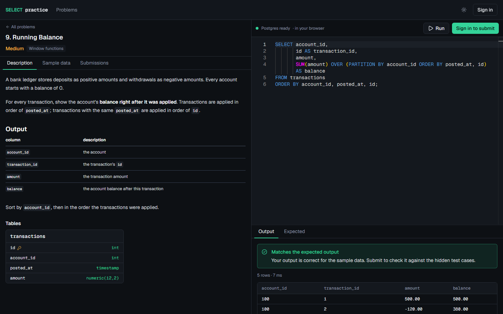
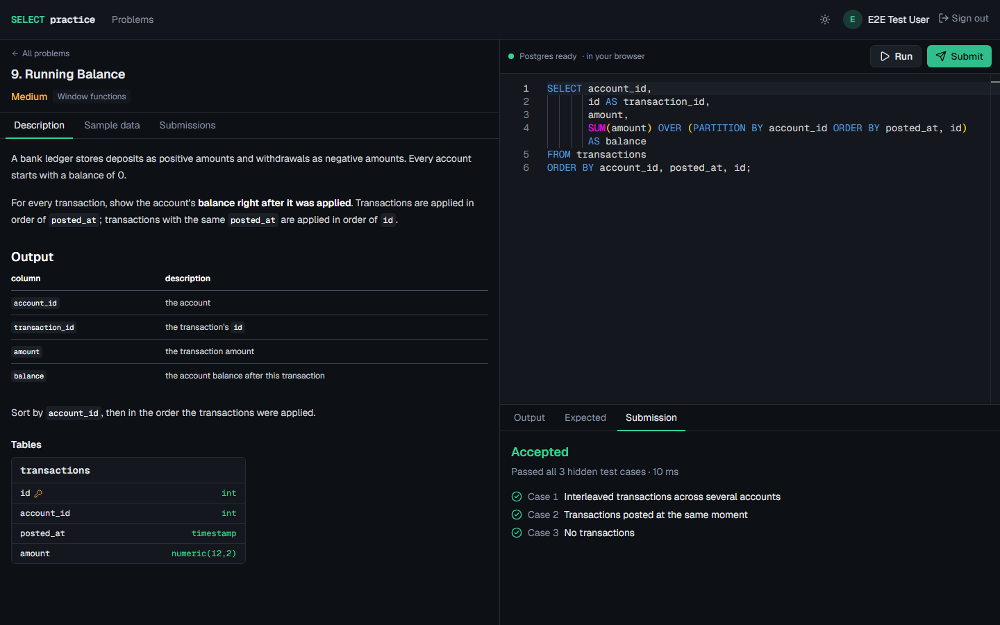
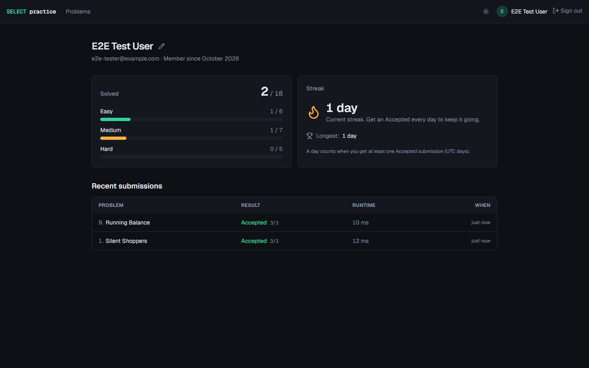
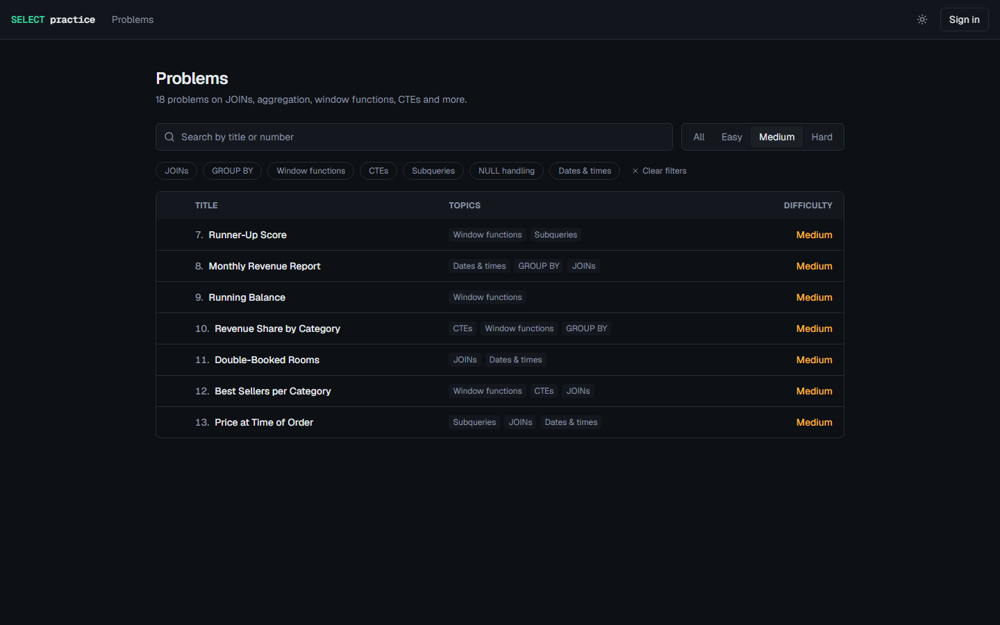
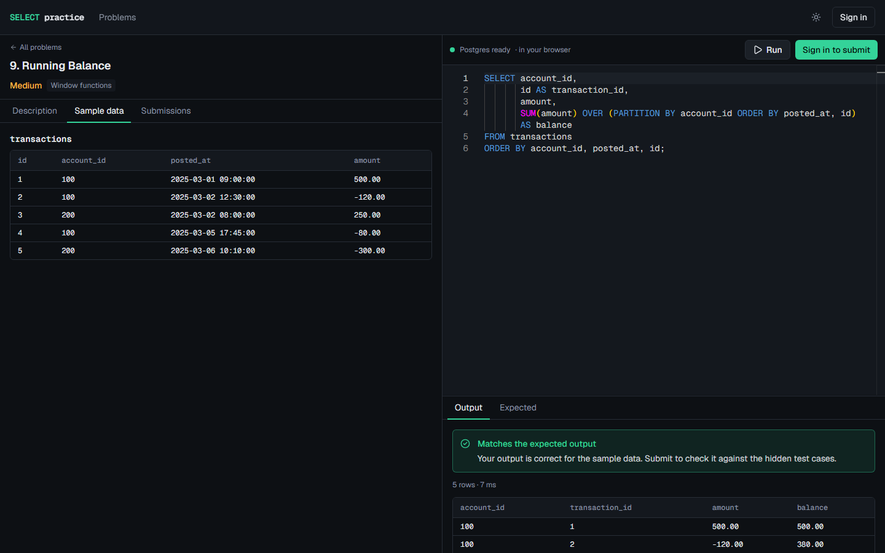
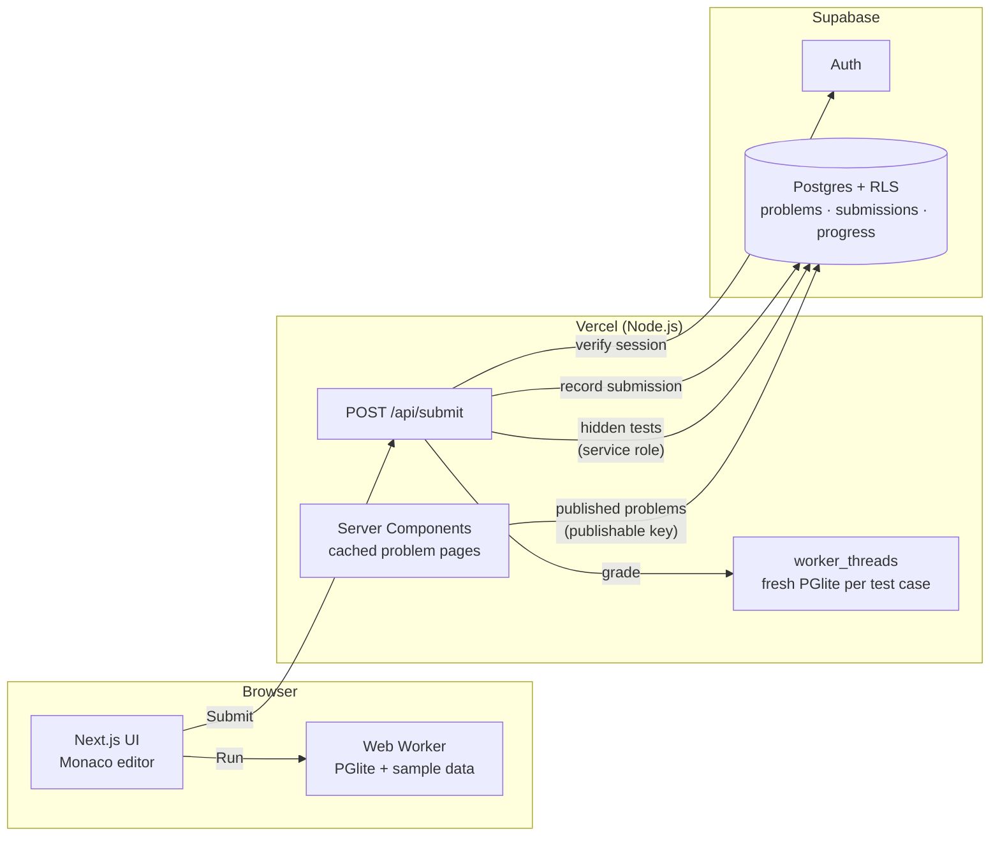
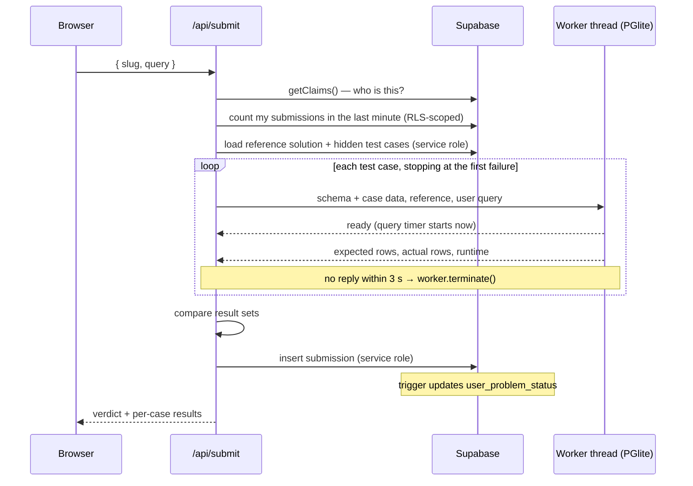

# SQL Practice

[](https://github.com/ArjieeAr/SQL-Practice/actions/workflows/ci.yml)

A LeetCode-style practice platform focused only on SQL. Read a problem, write a query in the
editor, **run it against a real Postgres that runs in your browser**, then **submit it to be
graded against hidden test cases** full of NULLs, ties, empty tables and boundary dates.



| Submitted and graded on hidden test cases               | Profile: progress and streak                         |
| ------------------------------------------------------- | ---------------------------------------------------- |
|  |         |
| **Problem list**                                        | **Sample data viewer**                               |
|           |  |

## Features

- **18 original problems** (6 easy, 7 medium, 5 hard) across JOINs, GROUP BY, window functions,
  CTEs, subqueries, NULL handling and dates.
- **Run** executes your query instantly in the browser on PGlite (Postgres compiled to
  WebAssembly) and compares it with the expected output for the sample data.
- **Submit** grades your query on the server against 3 hidden test cases per problem and tells
  you which case failed and why (without revealing its data).
- **Schema viewer** with column types, primary and foreign keys, and every sample row.
- **Monaco editor** with table/column completion, `Ctrl/Cmd + Enter` to run, error underlines
  at the exact position Postgres reports, and per-problem drafts.
- **Accounts** via email or GitHub (Supabase Auth). Anyone can browse and Run; signing in
  unlocks Submit, submission history, and a profile with solved counts and a daily streak.
- Dark by default, with a light theme; responsive down to phone width.

**Stack:** Next.js 16 (App Router, Cache Components) · TypeScript · Tailwind CSS v4 ·
Supabase (Postgres, Auth, RLS) · PGlite · Monaco · Vitest · Playwright · GitHub Actions · Vercel

## Architecture



Supabase only **stores** data: problems, hidden test cases, submissions and progress. **User SQL
never runs against it.** Every user query runs in a throwaway PGlite instance, either in the
browser (Run) or in a server worker thread (Submit).

### What happens on Submit



## Sandboxing design

The interesting engineering problem is running untrusted SQL safely. Every query, in the browser
and on the server, goes through the same module,
[`src/lib/sandbox/engine.mjs`](src/lib/sandbox/engine.mjs), so Run and Submit behave the same.

**Isolation.** PGlite is Postgres compiled to WebAssembly. It has no network access and no
access to the host filesystem or processes; even `COPY … TO PROGRAM` or `pg_read_file` only see
an in-memory virtual filesystem that is thrown away afterwards. Each test case gets a **fresh
instance**, so nothing a query does can leak into the next case or the next user.

**Read-only, single statement.** The user's query runs as
`DECLARE user_query NO SCROLL CURSOR FOR <query>` inside `BEGIN READ ONLY … ROLLBACK`, then
`FETCH 1001`. This makes Postgres itself enforce the rules, rather than a regex:

- `DECLARE … CURSOR` only accepts `SELECT`/`VALUES` and rejects data-modifying CTEs
  (`WITH x AS (DELETE …)`).
- PGlite's `query()` uses the extended protocol, which rejects multiple statements, so
  `SELECT 1; DROP TABLE …` fails.
- `FETCH 1001` caps how many rows are materialized. More than 1,000 is reported as too large.
- The reference solution runs **before** the user's query, so the expected output can't be
  tampered with.

**Timeouts need a separate thread.** PGlite runs queries synchronously inside WASM, which
blocks the JavaScript event loop. I measured this: with `SET statement_timeout = 500`, a 30M-row
query still ran for 9.8 s, and a 100 ms `setTimeout` didn't fire until it finished. So every
test case runs in a **`worker_threads` worker** (a **Web Worker** in the browser), and the parent
calls `worker.terminate()` when the 3-second budget expires. The budget starts only when the
worker reports that its data is loaded, so a cold start never counts against the user.

**Snapshot boot.** A cold PGlite boot runs `initdb`, which costs about 2 s. The server builds one
initialized, empty cluster per process, shares it with workers as a `SharedArrayBuffer`, and each
case restores from it instead. That cut per-case time from **~2.2 s to ~0.65 s**; a warm
3-case submission takes about 1–2 s.

**Limits:** 5,000-character queries, 1,000 result rows, 3 s per test case, 6 submissions per user
per minute.

**Residual risks.** These are accepted for this project, and they're what I'd harden first at
scale:

- WASM memory isn't bounded by V8's heap limits. A pathological query could exhaust the function's
  memory before the timeout. The blast radius is that one invocation; the rate limit bounds how
  often it can happen.
- The rate limit is a count-then-insert check, so two simultaneous requests can both slip under
  it. A Postgres function with an advisory lock (or a Redis counter) would make it exact.
- The query inside the sandbox runs as a superuser, which is harmless because there is nothing to
  reach, but a dedicated non-superuser role would be defense in depth.

### How results are compared

The comparison lives in [`src/lib/sql/compare.ts`](src/lib/sql/compare.ts), with unit tests in
[`tests/unit/sql`](tests/unit/sql):

- Values are compared as Postgres text, normalized by type OID:
  - `2.50` (numeric), `2.5` (float) and `2.5000000001` are equal (6 decimal places).
  - Integers keep full precision beyond 2^53.
  - `NULL` is distinct from `''` and `'null'`.
  - `char(n)` padding and JSON key order are ignored.
  - The text `'1'` is not the number `1`.
- Columns are matched by **position**, not name, so aliases are the user's choice.
- Rows are compared as a **multiset** (duplicates count) unless the problem says order matters;
  "right rows, wrong order" gets its own message.
- Failure messages ("Expected 3 rows, got 2.") never reveal hidden data.

## Data model and security

| Table                 | Contents                                               | Client access (RLS)          |
| --------------------- | ------------------------------------------------------ | ---------------------------- |
| `profiles`            | display name, avatar; created by a trigger on sign-up  | read and update **own**      |
| `problems`            | description, schema, sample data, derived previews     | read **published**           |
| `problem_solutions`   | reference SQL                                          | **none** (service role only) |
| `test_cases`          | hidden test data                                       | **none** (service role only) |
| `submissions`         | query, verdict, runtime, case counts                   | read **own**; no writes      |
| `user_problem_status` | attempts and first solve time; maintained by a trigger | read **own**; no writes      |

- **Clients can't write submissions at all.** Only the grader inserts them, using the service role.
  Otherwise anyone could `POST {status: "accepted"}` straight to Supabase.
- **Reference solutions get their own table.** RLS filters rows, not columns, so a separate table
  with no client policies is simpler and safer than column grants.
- **RLS plus explicit `REVOKE`s.** Supabase grants clients broad table privileges by default; the
  revokes mean a future policy mistake can't silently open up writes or hidden data.
- **`get_my_stats()` computes the streak in SQL** using gaps-and-islands:
  `day - row_number()` is constant across a run of consecutive days.

**Testing RLS without Docker.** The real migration files run in PGlite against a small Supabase
stand-in ([`tests/support/supabase-stub.sql`](tests/support/supabase-stub.sql)): the API roles,
`auth.users`, `auth.uid()` reading the JWT claims, and the default grants.
[`tests/integration/database.test.ts`](tests/integration/database.test.ts) then acts as signed-out,
Alice and Bob. Removing a `REVOKE` or loosening a policy makes it fail.

## Problems as code

Each problem is a folder in [`content/problems`](content/problems):

```
meta.json        number, title, difficulty, tags, orderMatters
problem.md       the description users read
schema.sql       CREATE TABLEs (public)
sample.sql       sample rows for Run (public)
solution.sql     reference solution (secret)
cases/*.sql      hidden test data; the "-- name" first line is shown when a case fails
pitfalls/*.sql   common WRONG answers that the hidden cases must reject
```

The **integrity test** ([`tests/integration/problems.test.ts`](tests/integration/problems.test.ts))
runs every reference solution on the sample data and every hidden case. It also requires every
pitfall to run cleanly but be rejected by at least one hidden case. The pitfalls are realistic
mistakes:

- `NOT IN` against a column containing NULLs
- `ROW_NUMBER` where ties count, or `RANK`/`DENSE_RANK` mix-ups
- `COUNT(*)` after a `LEFT JOIN`
- integer division before `ROUND`
- filtering a `LEFT JOIN`ed table in `WHERE`
- `ORDER BY` without a tiebreak inside a window

So the edge-case coverage is tested, not just claimed. `npm run seed` runs the same verification
and writes nothing unless every problem passes.

## Project structure

```
src/app/                 routes: /, /problems, /problems/[slug], /login, /profile,
                         /auth/callback, /api/submit
src/components/          UI, grouped by feature (problem, problems, profile, auth, layout)
src/lib/sql/             result normalization, comparison, query guard, limits (pure, tested)
src/lib/sandbox/         engine.mjs, browser + server workers, snapshot boot
src/lib/grader/          gradeSubmission(): verdict from per-case runs
src/lib/data/            server-side data access (cached public reads, RLS-scoped user reads)
src/lib/supabase/        server / browser / public / admin clients
src/proxy.ts             refreshes the Supabase session before rendering
content/problems/        the 18 problems (see above)
supabase/migrations/     schema, RLS, triggers, stats function
scripts/                 seed, e2e test user, README screenshots
tests/unit|integration|e2e
```

## Local setup

**Prerequisites:** Node.js 22+, and a free [Supabase](https://supabase.com) project. Docker isn't
needed.

1. **Clone, install dependencies, and configure the environment.**

   ```bash
   git clone https://github.com/ArjieeAr/SQL-Practice.git
   cd SQL-Practice
   npm install
   cp .env.example .env.local
   ```

   Fill in `NEXT_PUBLIC_SUPABASE_URL`, `NEXT_PUBLIC_SUPABASE_PUBLISHABLE_KEY` and
   `SUPABASE_SECRET_KEY` from the Supabase dashboard (Project Settings → API Keys).

2. **Create the schema and load the problems.**

   ```bash
   npx supabase login
   npm run db:link -- --project-ref <your-project-ref>
   npm run db:push      # apply supabase/migrations
   npm run seed         # verify and upload content/problems
   ```

3. **Configure auth** in the Supabase dashboard (Authentication):
   - **URL Configuration:** set Site URL to `http://localhost:3000` and add
     `http://localhost:3000/**` to Redirect URLs.
   - **GitHub (optional):** create a GitHub OAuth App with the callback
     `https://<project-ref>.supabase.co/auth/v1/callback`, then paste its client ID and secret
     under Providers → GitHub.
   - For quick local testing you can turn off **Confirm email** (Providers → Email). Supabase's
     built-in mailer only sends a few emails per hour.

4. **Run it.**
   ```bash
   npm run dev
   ```

## Scripts

| Script                  | What it does                                                        |
| ----------------------- | ------------------------------------------------------------------- |
| `npm run dev` / `build` | Next.js dev server / production build                               |
| `npm run lint`          | ESLint                                                              |
| `npm run typecheck`     | Generate route types, then `tsc` (including the JSDoc-typed `.mjs`) |
| `npm test`              | Vitest: unit + integration (sandbox, RLS, problem integrity)        |
| `npm run test:e2e`      | Playwright: smoke test and the solve flow                           |
| `npm run seed:check`    | Verify every problem in the sandbox; no network                     |
| `npm run seed`          | Verify, then upload problems and hidden test cases                  |
| `npm run db:push`       | Apply migrations to the linked Supabase project                     |
| `npm run db:types`      | Regenerate `src/types/database.ts` from the linked project          |
| `npm run e2e:user`      | Create or reset the account the signed-in e2e test uses             |
| `npm run screenshots`   | Re-capture `docs/screenshots` from a running app                    |

## Testing

- **Unit:** normalization and comparison edge cases, the query guard, grading verdicts (with a
  fake runner), filtering, redirect sanitizing, time formatting.
- **Integration:**
  - The real sandbox in real worker threads: timeouts, the row cap, multi-statement and
    data-modifying-CTE rejection, error positions.
  - The real migrations and RLS policies in PGlite.
  - The integrity of all 18 problems.
- **End to end (Playwright):**
  - A visitor runs the `NOT IN` pitfall and sees "Differs", fixes it and sees "Matches".
  - A signed-in user submits and gets Accepted, and the submission appears in history.

  The signed-in test needs a throwaway account. Set `E2E_USER_EMAIL` and `E2E_USER_PASSWORD`
  in `.env.local`, then run `npm run e2e:user`. Without them the test skips.

**CI** ([`.github/workflows/ci.yml`](.github/workflows/ci.yml)) runs lint, format check,
typecheck and all Vitest suites. It then builds the app and runs Playwright against it.

## Deploying

**Supabase:**

1. Apply migrations to your project and seed it (`npm run db:push`, `npm run seed`).
2. Add your production URL under Authentication → URL Configuration: set the Site URL and add
   `https://<your-domain>/**` to Redirect URLs.
3. Set the GitHub OAuth App's homepage URL to your production URL. The callback stays the
   Supabase one.
4. Turn **Confirm email** back on.

**Vercel:**

1. Import the GitHub repository. The defaults (Next.js, `npm run build`) are correct.
2. Add these environment variables for Production and Preview:
   `NEXT_PUBLIC_SUPABASE_URL`, `NEXT_PUBLIC_SUPABASE_PUBLISHABLE_KEY`, `SUPABASE_SECRET_KEY`,
   and `NEXT_PUBLIC_SITE_URL` (your production URL).
3. Deploy. The grader route uses the Node.js runtime with `maxDuration = 60`, and PGlite's WASM
   files are traced into the function bundle automatically. Its unused extension tarballs are
   excluded in `next.config.ts`.

**GitHub Actions secrets** (Settings → Secrets and variables → Actions):

| Secret                                 | Needed for                                           |
| -------------------------------------- | ---------------------------------------------------- |
| `NEXT_PUBLIC_SUPABASE_URL`             | building (problem pages are prerendered)             |
| `NEXT_PUBLIC_SUPABASE_PUBLISHABLE_KEY` | building                                             |
| `SUPABASE_SECRET_KEY`                  | the signed-in e2e test (Submit grades on the server) |
| `E2E_USER_EMAIL`, `E2E_USER_PASSWORD`  | the signed-in e2e test (skipped without them)        |

## Design decisions and trade-offs

- **PGlite instead of a hosted grading database.** It's free, needs no infrastructure, and is
  fully isolated per run. A dedicated grading service with real Postgres and `statement_timeout`
  would scale better and be closer to production; I'd move there under real load.
- **Precomputed previews.** The seed script stores each problem's expected sample output and its
  table previews, so the schema viewer and "Expected" tab render instantly instead of waiting
  2–3 s for Postgres to boot in the browser. They're derived only from public data.
- **Cache Components.** Problem pages are prerendered and cached, so they're identical for
  everyone. Per-user parts (header, solved marks, history) stream in behind `<Suspense>`. On the
  problem list the user's progress is passed to the client as a promise, so filters you touch
  aren't reset when it arrives.
- **Problems as code, not a CMS.** They're reviewable in pull requests, verified in CI, and
  uploaded by an idempotent seed. The trade-off is that adding a problem needs a deploy-time
  seed.
- **Not-found inside a stream.** Unknown problem slugs render the 404 page with HTTP 200 plus
  `noindex`, because the lookup happens inside a streamed Suspense boundary.

## Possible next steps

- A non-superuser sandbox role and an exact, lock-based rate limit (see residual risks).
- Public profiles and per-problem acceptance rates.
- Hints and an "explain why my result differs" diff for the sample data.
